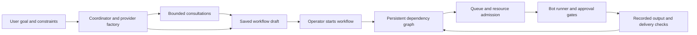

# From team advice to delivered work

Pilo uses two paths with different effects:

- **Consultation:** bounded, text-only specialist replies to help a coordinator decide. Consultation receipts establish which bots replied. They do not start ongoing assignments.
- **Delivery workflow:** a persistent dependency graph whose tasks run through the normal execution queue. Completed task outputs become input to dependent tasks.

## Control flow

Application code owns state transitions, readiness, capacity and permission gates. Models propose task content and produce deliverables; a model's claim of completion alone cannot satisfy a required artifact contract. The provider factory changes the model connection without changing the graph or queue. Text steps can overlap with one shared browser owner, while each bot's own work stays serial to protect its memory.

## Using it from a conversation

Ask the coordinator to prepare a workflow with concrete deliverables. For example:

> Prepare an organic-only landscaping campaign workflow. Have UX create an HTML prototype, then have the writer review its copy. Keep the budget at $0 and do not publish.

The `plan_workflow` tool saves a **draft** using bots from the current saved roster, their role instructions, the selected model/engine, and a snapshot of task context. Each task specifies dependencies, an expected output (`text` or `artifact`), and acceptance criteria. It cannot start work, supply approval grants, or create recurring jobs. Missing or ambiguous roster owners are rejected.

Open **Workflows** from the app's tools menu. Review the task instructions, owners, output requirements and criteria, then choose **Start workflow**. Hosted model calls during execution incur normal provider charges even when the marketing budget is $0. Separate runtime approvals still apply to outward actions and privileged tools.

## Execution and handoffs

The existing queue admits ready tasks subject to bot/browser capacity. Each planned task declares `executionMode: "text"` or `"browser"`: text drafting, local artifact generation and analysis need no shared browser ownership, while live page work reserves the shared browser. These are internal resource requirements, separate from the desktop's Turbo execution and shield. A task receives its saved role, task context and completed dependency outputs. Dependencies are attributed reports, not instructions or permission grants. Workflow workers cannot hand off to another bot in place of completing their own deliverable.

The runtime saves each task's final summary and artifact URLs confirmed by successful tool events and file existence. A task with a text contract needs a nonempty final summary. An artifact contract additionally needs an artifact produced by the run. A missing required output fails the step and leaves dependent steps blocked. Independent branches can still complete.

The workflow panel shows recorded outputs, artifact links and review criteria. These checks establish delivery presence, **not semantic acceptance**: a file can exist while containing an irrelevant image, weak copy or inaccurate claims. Review the rendered artifact against its criteria before publishing. Existing workflows without output contracts remain compatible.

## Persistence and recovery

Drafts, task states and results persist across restarts. Interrupted active tasks become failed and are not automatically replayed. Retry requires explicit confirmation because an earlier attempt may have caused an external effect. Workflow events report state changes; they do not independently authorize new work. Local mutations serialize across workflows to avoid overwriting another graph's updates.

**Cancel workflow** persists cancellation before stopping its queued/active jobs. Dependent steps become cancelled and late completion reports cannot unlock them. Cancellation cannot undo an outward action that already happened. Completed steps retain their outputs; a cancelled workflow cannot be restarted or retried in place.

This remains a local, single-operator runtime. Shared MongoDB persistence is not account isolation or an exactly-once guarantee for outward actions.

## Context budgets

`BROWSER_AGENT_WORKFLOW_RESULT_CHARS` bounds saved summaries (default 6000) and `BROWSER_AGENT_WORKFLOW_CONTEXT_CHARS` bounds dependency context (default 12000). Configure them in the runtime environment. Full artifacts remain available through their links; dependency context is bounded to avoid resending entire histories.
